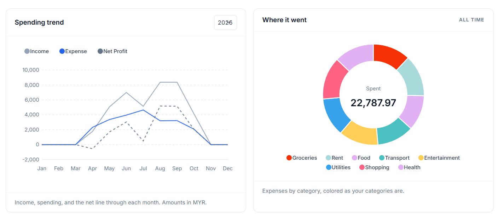

# 💰 Fortuna

A personal finance and expense tracker built with Laravel. Fortuna records every transaction the moment it happens, files each receipt next to its entry, and holds your spending up against the budgets you set.



## ✨ Features

- 📊 Dashboard with total balance, monthly income, monthly spending, and budget remaining
- 📈 Spending trend and expense distribution charts powered by ApexCharts
- 💸 Create, edit, and delete income and expense transactions
- 🔍 Search, filters for type, category, amount, and date, four sort orders, and bulk delete
- 📎 Receipt uploads that stream back only to the account that owns them
- 🗂 Income and expense categories with colors used across charts and reports
- 🎯 Monthly budgets per category with actual vs budget tracking and overshoot alerts
- 📆 Yearly reports with monthly breakdowns, savings rate, and year-over-year comparison
- 📤 CSV export of transactions that follows the active filters
- 🖨 PDF monthly summary with totals, budget performance, and top categories
- 🔐 Authentication with Laravel Breeze, covering registration, login, verification, and password reset
- 🧩 JSON API secured with Laravel Sanctum

## 🛠 Built with

- PHP 8.3 or newer on Laravel 13
- Blade templates and Tailwind CSS
- ApexCharts for the dashboard and report charts
- barryvdh/laravel-dompdf for the monthly summary PDF
- Laravel Breeze for authentication
- Laravel Sanctum for the JSON API
- SQLite by default, with any database Laravel supports as a drop-in
- PHPUnit for tests and Laravel Pint for code style

## 🚀 Getting started

You need PHP 8.3 or newer with the `pdo_sqlite` extension, Composer, and Node.js with npm.

```bash
# PHP and JavaScript dependencies
composer install
npm install

# Environment
cp .env.example .env
php artisan key:generate

# Database
touch database/database.sqlite
php artisan migrate --seed

# Front end
npm run build
```

On Windows PowerShell, use `copy .env.example .env` and `New-Item database/database.sqlite` for the two shell lines.

Then serve the app at http://localhost:8000.

```bash
php artisan serve
```

During development, `composer run dev` starts the application server, the queue worker, the log tailer, and Vite together. `composer run setup` performs the whole install, environment, migration, and build sequence in one step, with the SQLite file created beforehand.

The database seeder builds a demo account, `test@example.com` with the password `password`, and fills it with categories, months of transactions, and budgets so every chart and report has data.

## 🧪 Testing

```bash
php artisan test --compact
```

Feature tests cover transaction CRUD and filters, the CSV export, budgets, categories, the reports page, the monthly summary PDF, and the authentication and profile flows. `composer test` runs the same suite with a cleared config.

## 📁 Project structure

- `app/Http/Controllers` holds the page controllers and the JSON API controllers
- `app/Models` holds User, Category, Transaction, and Budget
- `resources/views` holds the Blade templates, with the app shell in `layouts/app.blade.php`
- `routes/web.php` serves the pages and `routes/api.php` serves the JSON API

## 📄 License

Released under the MIT license.
